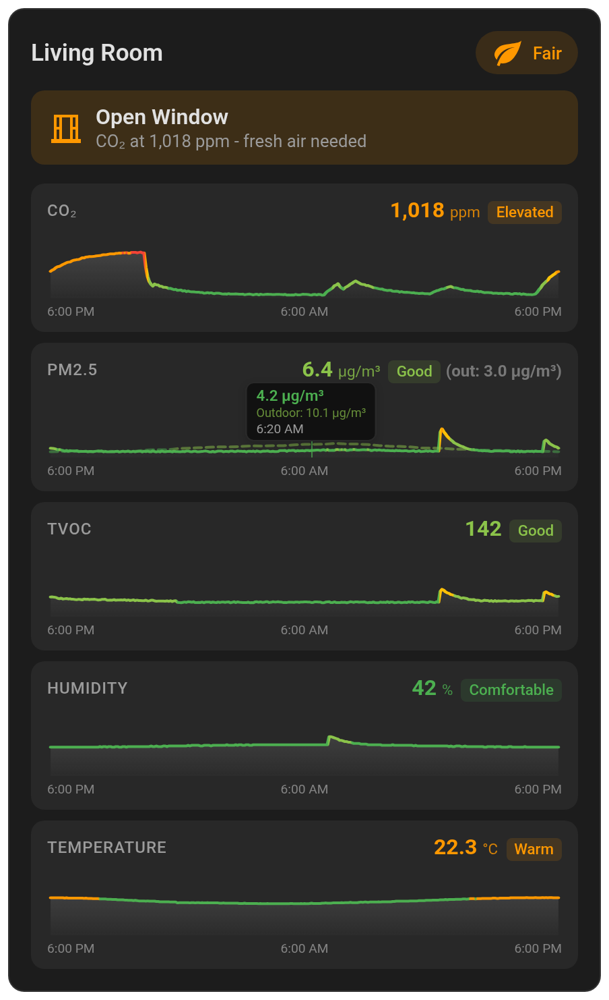
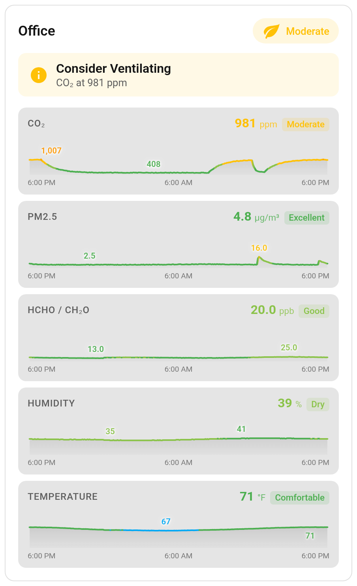
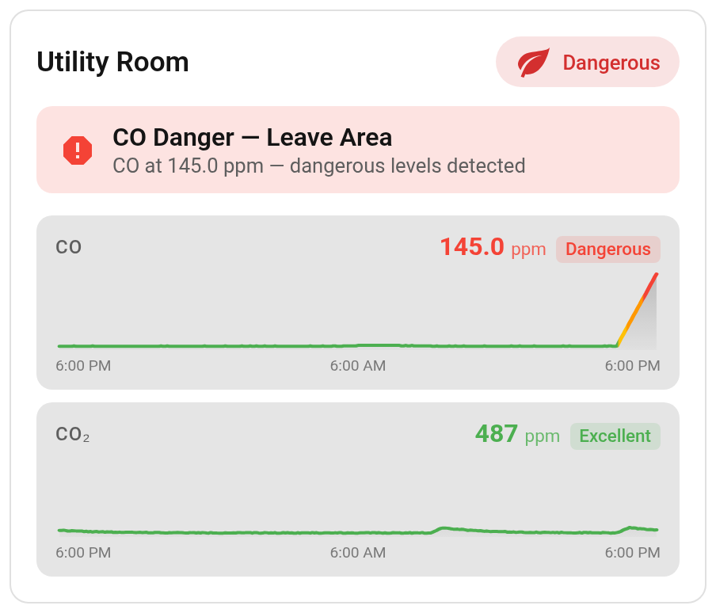
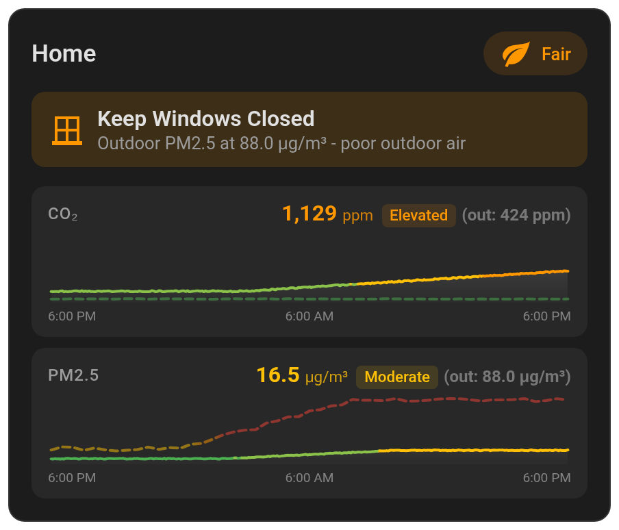
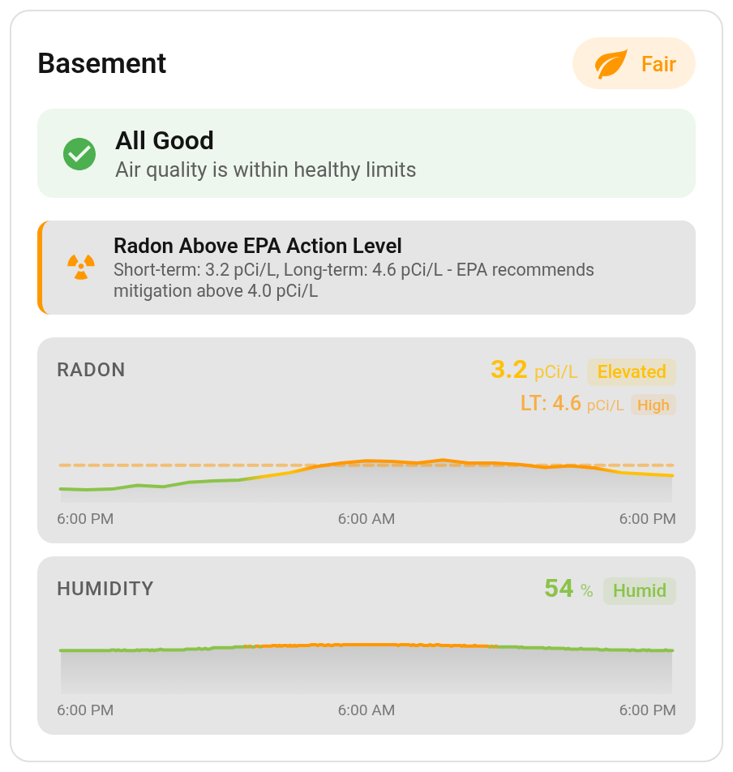
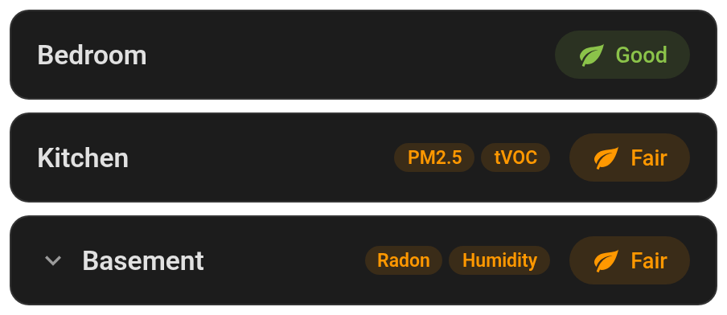
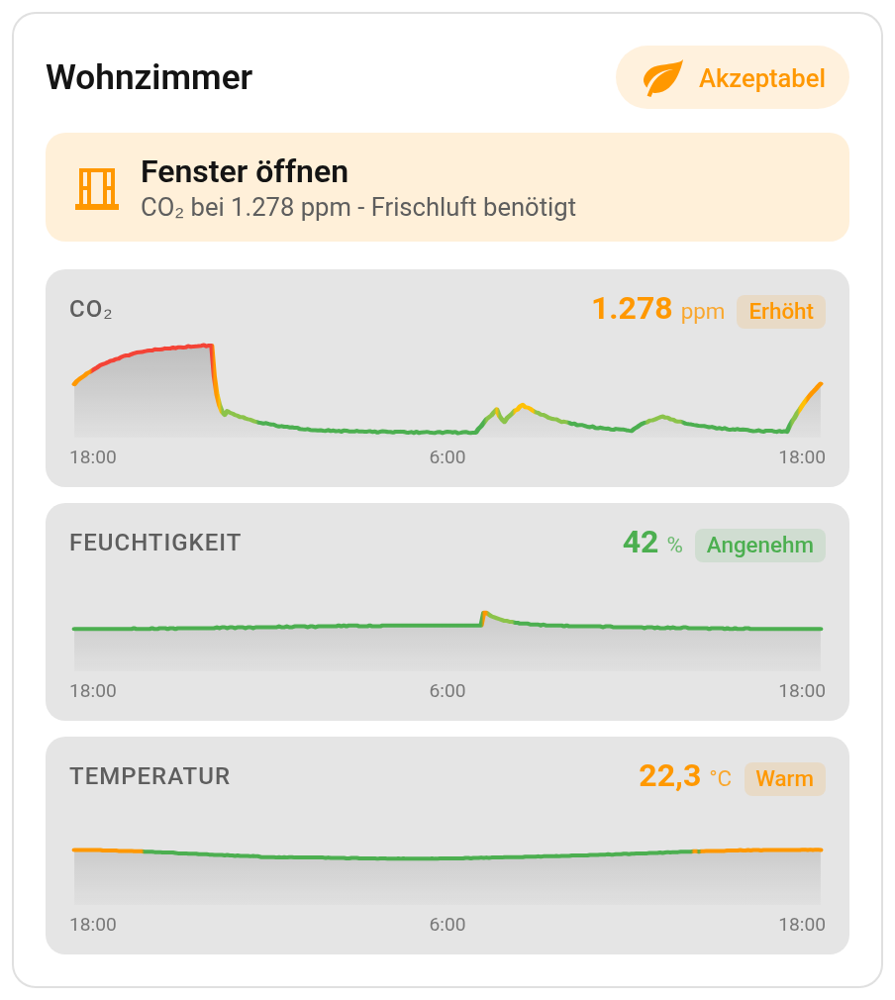
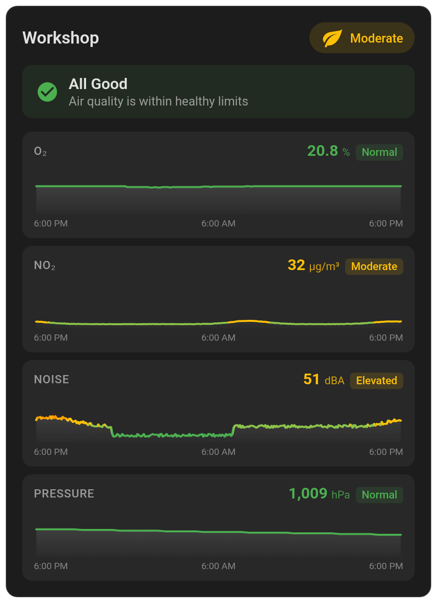

<h1 align="center">Air Quality Card</h1>

<p align="center">
  A Home Assistant dashboard card that turns your air-quality sensors into live, color-graded graphs<br>
  and plain-language advice, based on WHO, US EPA, OSHA and EU guidance.
</p>

<p align="center">
  <a href="https://github.com/hacs/integration"></a>
  <a href="https://github.com/KadenThomp36/air-quality-card/releases/latest"></a>
  
  <a href="LICENSE"></a>
  <a href="https://buymeacoffee.com/kadenthomp36"></a>
</p>

<p align="center">
  
  
</p>

<table>
  <tr>
    <td width="33%" valign="top">
      
      <p><b>Life-safety alerts</b><br>Carbon monoxide, propane leaks and low oxygen take over the whole card with a red warning, and nothing can mask them.</p>
    </td>
    <td width="33%" valign="top">
      
      <p><b>Outdoor-aware advice</b><br>Add outdoor sensors and the card compares them with indoor air, so it says "Keep Windows Closed" when the smoke is outside.</p>
    </td>
    <td width="33%" valign="top">
      
      <p><b>Radon advisory</b><br>Short- and long-term radon in pCi/L or Bq/m³, with its own advisory at the WHO reference and EPA action levels.</p>
    </td>
  </tr>
  <tr>
    <td width="33%" valign="top">
      
      <p><b>Compact &amp; expandable</b><br>A one-line summary for overview dashboards, with chips naming whatever is out of range. Tap to expand.</p>
      
      <p><b>Your language and formats</b><br>Seven languages, and numbers, clock and time zone follow your Home Assistant profile.</p>
    </td>
    <td width="33%" valign="top">
      
      <p><b>19 kinds of sensors</b><br>From CO₂ and particulates to radon, formaldehyde, NOx, ozone, oxygen, propane, noise and pressure. Use any combination.</p>
    </td>
    <td width="33%" valign="top">
      <p><b>What else it does</b></p>
      <ul>
        <li>Graphs update live and slide with time</li>
        <li>Hover or press-and-hold to read any point</li>
        <li>Tap a graph for Home Assistant's history</li>
        <li>Converts µg/m³, mg/m³, ppb and ppm automatically</li>
        <li>Every threshold is overridable</li>
        <li>Visual editor, no YAML needed</li>
        <li>Tap, hold and double-tap actions, plus a one-tap button for the recommendation</li>
      </ul>
    </td>
  </tr>
</table>

## Contents

- [Installation](#installation)
- [Quick start](#quick-start)
- [Configuration](#configuration)
- [Guides](#guides)
- [How the recommendations work](#how-the-recommendations-work)
- [Health thresholds](#health-thresholds)
- [Supported devices](#supported-devices)
- [Development](#development)

## Installation

### HACS (recommended)

[](https://my.home-assistant.io/redirect/hacs_repository/?owner=KadenThomp36&repository=air-quality-card&category=plugin)

Or open HACS, search for **Air Quality Card**, install it, and refresh your browser.

### Manual

1. Download `air-quality-card.js` from the [latest release](https://github.com/KadenThomp36/air-quality-card/releases/latest).
2. Copy it to `/config/www/air-quality-card/air-quality-card.js`.
3. In Home Assistant, go to **Settings → Dashboards → ⋮ → Resources** and add `/local/air-quality-card/air-quality-card.js` as a **JavaScript module**.

## Quick start

Add a card to your dashboard and search for **Air Quality Card**. The visual editor picks up sensors from one of your devices; adjust them, then open the **Additional sensors**, **Outdoor sensors**, **Interactions** and **Advanced** sections for everything else.

Or in YAML, using whichever sensors you have:

```yaml
type: custom:air-quality-card
name: Living Room
co2_entity: sensor.living_room_co2
pm25_entity: sensor.living_room_pm25
humidity_entity: sensor.living_room_humidity
temperature_entity: sensor.living_room_temperature
outdoor_pm25_entity: sensor.outdoor_pm25   # optional: enables the outdoor comparison
```

## Configuration

At least one sensor is required; every other option is optional.

### Sensors

| Option | Sensor | Accepted units |
|--------|--------|----------------|
| `co2_entity` | Carbon dioxide | ppm |
| `pm25_entity` | PM2.5 | µg/m³ |
| `pm10_entity` | PM10 | µg/m³ |
| `pm1_entity` | PM1 | µg/m³ |
| `pm4_entity` | PM4 | µg/m³ |
| `pm03_entity` | PM0.3 particle count | particles / 0.1 L |
| `co_entity` | Carbon monoxide | ppm (ppb, mg/m³, µg/m³ converted automatically) |
| `hcho_entity` | Formaldehyde | ppb (ppm, mg/m³, µg/m³ converted automatically) |
| `tvoc_entity` | Total VOCs | ppb, or the unitless Sensirion VOC Index (auto-detected, see `tvoc_unit`) |
| `nox_entity` | Nitrogen oxides | ppb, or the unitless Sensirion NOx Index (auto-detected, see `nox_unit`) |
| `no2_entity` | Nitrogen dioxide | µg/m³ (ppb, ppm converted automatically) |
| `o3_entity` | Ozone | µg/m³ (ppb, ppm converted automatically) |
| `o2_entity` | Oxygen | %vol |
| `c3h8_entity` | Propane (combustible-gas leak) | %vol |
| `radon_entity` | Radon (short-term) | pCi/L or Bq/m³ |
| `radon_longterm_entity` | Radon long-term average (dashed overlay on the radon graph) | pCi/L or Bq/m³ |
| `humidity_entity` | Relative humidity | % |
| `temperature_entity` | Temperature | °C or °F |
| `pressure_entity` | Atmospheric pressure | hPa (other units: set `pressure_thresholds`) |
| `noise_entity` | Sound level | dB / dBA |
| `air_quality_entity` | An overall air-quality index to show in the header ([details](#air-quality-index-entity)) | — |

**Outdoor sensors** draw a dashed comparison line on the matching graph and feed the outdoor-aware advice: `outdoor_co2_entity`, `outdoor_pm25_entity`, `outdoor_pm10_entity`, `outdoor_pm1_entity`, `outdoor_pm03_entity`, `outdoor_co_entity`, `outdoor_hcho_entity`, `outdoor_tvoc_entity`, `outdoor_nox_entity`, `outdoor_no2_entity`, `outdoor_o3_entity`, `outdoor_humidity_entity`, `outdoor_temperature_entity`, `outdoor_pressure_entity`.

### Display

| Option | Default | Description |
|--------|---------|-------------|
| `name` | `Air Quality` | Card title |
| `display` | `full` | `full` (graphs and details), `compact` (status badge only), or `expandable` (compact, tap to expand). See [Display modes](#display-modes) |
| `hours_to_show` | `24` | Hours of history in the graphs (1–168) |
| `y_scale` | `fixed` | `fixed` keeps each graph on its metric's full range so colors stay comparable; `auto` zooms to the data (10% headroom) to show small changes |
| `show_min_max` | `false` | Mark the window's minimum and maximum on each graph |
| `show_status_banner` | `true` | Show the recommendation banner ("All Good", "Open Window", …) |
| `compact_alerts` | `true` | In compact/collapsed view, show chips naming the sensors that are out of range |
| `auto_expand` | `false` | With `display: expandable`, expand while any sensor is out of range and collapse after 5 minutes back to normal |
| `order` | default order | Graph order, as a list of metric names ([details](#sensor-order)) |
| `language` | `auto` | `auto` (Home Assistant's language), `en`, `es`, `fr`, `de`, `pt`, `hu` or `pl` |

### Units

| Option | Default | Description |
|--------|---------|-------------|
| `temperature_unit` | `auto` | `auto` (the sensor's unit, else Home Assistant's unit system), `C` or `F` |
| `temperature_decimals` | `false` | Show temperatures with one decimal place. Without it, a **Display precision** set on the entity in Home Assistant is used |
| `radon_unit` | `auto` | `auto` (from the sensor), `pCi/L` or `Bq/m³` |
| `tvoc_unit` | `auto` | `auto`, `ppb` (absolute) or `index` (Sensirion VOC Index) |
| `nox_unit` | `auto` | `auto`, `ppb` (absolute) or `index` (Sensirion NOx Index) |

### Actions

Standard [Home Assistant actions](https://www.home-assistant.io/dashboards/actions/) (`more-info`, `navigate`, `perform-action`, `toggle`, `url`, …).

| Option | Description |
|--------|-------------|
| `tap_action` | Tapping the compact card (in expandable mode, a tap expands instead) |
| `hold_action` | Holding the compact card for half a second |
| `double_tap_action` | Double-tapping the compact card |
| `recommendation_action` | A one-tap button on the recommendation banner, e.g. switch on a purifier ([details](#recommendation-action-button)) |

Tapping a graph always opens Home Assistant's history for that sensor.

### Thresholds

Each metric's color tiers can be overridden with 4 ascending numbers ([details](#custom-thresholds)). The defaults and their sources are under [Health thresholds](#health-thresholds).

| Option | Default |
|--------|---------|
| `co2_thresholds` | `[600, 800, 1000, 1500]` ppm |
| `pm25_thresholds` | `[5, 15, 25, 35]` µg/m³ |
| `pm10_thresholds` | `[15, 45, 75, 150]` µg/m³ |
| `pm1_thresholds` | `[5, 15, 25, 35]` µg/m³ |
| `pm4_thresholds` | `[10, 25, 37.5, 50]` µg/m³ |
| `pm03_thresholds` | `[500, 1000, 3000, 5000]` particles / 0.1 L |
| `co_thresholds` | `[4, 9, 35, 100]` ppm |
| `hcho_thresholds` | `[20, 50, 100, 200]` ppb |
| `tvoc_thresholds` | `[100, 300, 500, 1000]` ppb, or `[100, 150, 250, 400]` VOC Index |
| `nox_thresholds` | `[20, 53, 100, 360]` ppb, or `[5, 20, 150, 300]` NOx Index |
| `no2_thresholds` | `[10, 25, 40, 200]` µg/m³ |
| `o3_thresholds` | `[60, 100, 180, 240]` µg/m³ |
| `o2_thresholds` | `[16, 19.5, 23.5, 25]` % |
| `c3h8_thresholds` | `[0.05, 0.21, 0.42, 1.05]` % |
| `radon_thresholds` | `[48, 100, 148, 300]` Bq/m³ (always Bq/m³, even when displaying pCi/L) |
| `humidity_thresholds` | `[30, 40, 50, 60]` % |
| `temperature_thresholds` | `[18, 20, 22, 24]` °C or `[65, 68, 72, 76]` °F |
| `pressure_thresholds` | `[990, 1005, 1025, 1040]` hPa |
| `noise_thresholds` | `[35, 45, 55, 70]` dB |
| `air_quality_thresholds` | none (tiers a numeric `air_quality_entity`) |

## Guides

### Display modes

`display: full` (the default) shows everything. Two smaller modes suit overview dashboards and phones.

#### Compact

`display: compact` shows just the title and the overall status badge, optionally with [tap actions](https://www.home-assistant.io/dashboards/actions/) — e.g. a small indicator that opens your air-quality page.

When a sensor is out of range, colored **alert chips** next to the badge name it, most severe first (life-safety sensors always lead), up to four plus a `+N` pill. So a yellow badge tells you *what* is off without opening anything. Set `compact_alerts: false` to hide them. Atmospheric pressure never produces a chip: it's informational, not an air-quality hazard.

```yaml
type: custom:air-quality-card
name: Air Quality
co2_entity: sensor.air_quality_co2
pm25_entity: sensor.air_quality_pm25
display: compact
tap_action:
  action: navigate
  navigation_path: /lovelace/air-quality
```

`tap_action`, `hold_action` and `double_tap_action` use Home Assistant's timings: a hold is half a second, and when a double-tap action is set, a single tap waits a quarter of a second to tell the two apart. The card is keyboard-accessible too: Tab to it and press Enter or Space. Compact cards don't load history, so they're very light.

#### Expandable

`display: expandable` starts as the compact summary and expands to the full card when tapped; tap the header to collapse it again. History loads the first time you expand.

```yaml
type: custom:air-quality-card
name: Air Quality
co2_entity: sensor.air_quality_co2
pm25_entity: sensor.air_quality_pm25
display: expandable
```

Here a tap always expands or collapses, so `tap_action` is ignored; `hold_action` and `double_tap_action` still work.

If the layout gives the card a fixed height (a resized card in a sections view sets `grid_options: rows:`), the expanded card pops over the cards below instead of pushing them down. Set `grid_options: rows: auto` to have it push them down.

With `auto_expand: true` the card manages itself: it expands while any sensor is out of range and collapses after readings have been normal for 5 minutes, so a sensor hovering at a threshold doesn't make it flap. Tapping it yourself turns auto-expand off until the page is reloaded or the dashboard edited.

```yaml
type: custom:air-quality-card
co2_entity: sensor.air_quality_co2
pm25_entity: sensor.air_quality_pm25
display: expandable
auto_expand: true
```

### Outdoor sensors

Add any `outdoor_*_entity` to draw outdoor conditions as a **dashed line** on the matching graph. The current outdoor value appears next to the indoor reading, and hovering shows both.

Outdoor PM2.5 and CO₂ also feed the advice: when outdoor air is worse than indoor, the card says "Keep Windows Closed" (or "Run Air Purifier") instead of "Open Window".

### Outdoor-only mode

To monitor **only outdoor air** (a weather station, an ESPHome sensor on the balcony), configure just `outdoor_*_entity` options. The outdoor sensors become the main graph lines, the status badge uses the same thresholds, and the recommendation banner is hidden, since "Open Window" doesn't apply to ambient air.

```yaml
type: custom:air-quality-card
name: Outdoor Air Quality
outdoor_pm25_entity: sensor.outdoor_pm25
outdoor_pm10_entity: sensor.outdoor_pm10
outdoor_temperature_entity: sensor.outdoor_temperature
```

### Custom thresholds

The defaults follow WHO, EPA, OSHA and EU guidance where it exists, but you can override any of them with **4 ascending numbers**: the boundaries between the 5 tiers (Excellent / Good / Moderate / Elevated / Poor for most metrics; see [Health thresholds](#health-thresholds) for each metric's labels).

```yaml
type: custom:air-quality-card
temperature_entity: sensor.living_room_temp
temperature_unit: C
# In tropical climates, 26-29 °C is comfortable AC territory
temperature_thresholds: [22, 25, 28, 31]
# Stricter PM2.5 expectations than WHO 24h guideline
pm25_thresholds: [3, 8, 15, 25]
```

- Write thresholds in the unit your sensor reports. For CO, HCHO, NO₂ and O₃: with the default thresholds the card converts your reading into the default unit (µg/m³ CO → ppm, say); once you set `co_thresholds` etc., the reading stays in your sensor's unit and is compared with your numbers directly.
- Radon thresholds are always in **Bq/m³**; the card converts pCi/L readings before comparing.
- Your thresholds drive everything: the sensor badges, the header status, the recommendations and the graph's range.
- Invalid thresholds (wrong length, not numbers) quietly fall back to the defaults.
- Only the boundaries are configurable, not the colors.

### Recommendation action button

Adds a one-tap button to the recommendation banner, to act on what the card suggests: switch on a purifier when it says "Run Air Purifier", or run a script. It takes any [standard action](https://www.home-assistant.io/dashboards/actions/) and only appears when there's something to act on (not on "All Good").

```yaml
type: custom:air-quality-card
co2_entity: sensor.air_quality_co2
pm25_entity: sensor.air_quality_pm25
recommendation_action:
  action: perform-action
  perform_action: homeassistant.toggle
  target:
    entity_id: fan.air_purifier
```

For different actions per recommendation (purifier vs. ventilation), point it at a script that branches on your sensor states.

### Air quality index entity

By default the header status is computed from your sensors. Set `air_quality_entity` to show an index entity's value there instead: its state is shown as-is and colored using the standard Home Assistant AQI states (`good` / `moderate` / `fair` / `poor` / `very_poor` / `extremely_poor`).

If your index entity reports a **number** instead of a status word (e.g. Netatmo's Healthy Home Coach health index, where 0 = healthy and 4 = unhealthy), add `air_quality_thresholds` — four ascending boundaries mapping the number onto Excellent / Good / Fair / Poor / Very Poor:

```yaml
type: custom:air-quality-card
air_quality_entity: sensor.healthy_home_coach_air_quality
air_quality_thresholds: [1, 2, 3, 4]  # Netatmo health index: 0=Excellent … 4=Very Poor
```

Even with an `air_quality_entity`, a dangerous CO, propane or low-oxygen reading always takes over the badge, since an index entity knows nothing about a gas leak.

### Sensor order

Choose which graphs come first. In the visual editor, tick metrics in the order you want them; in YAML, list metric names. Metrics you don't list keep their default position.

Valid metric names: `co`, `c3h8`, `o2`, `radon`, `co2`, `pm25`, `pm10`, `pm1`, `pm03`, `pm4`, `hcho`, `tvoc`, `nox`, `no2`, `o3`, `noise`, `humidity`, `temperature`, `pressure`.

```yaml
type: custom:air-quality-card
co2_entity: sensor.air_quality_co2
humidity_entity: sensor.air_quality_humidity
temperature_entity: sensor.air_quality_temp
pm10_entity: sensor.air_quality_pm10
pm25_entity: sensor.air_quality_pm25
order:
  - temperature
  - humidity
  - co2
  - pm10
  - pm25
```

### Language and formats

The card speaks **English, Spanish, French, German, Portuguese, Hungarian and Polish**, following your Home Assistant language. Force one with `language: es` (or `en` / `fr` / `de` / `pt` / `hu` / `pl`).

Formats follow your Home Assistant profile, like the rest of your dashboard: **Number format** (decimal comma, grouping), **Time format** (12 or 24 hours, independent of language) and **Time zone** ("Use server time zone").

To add a language, open a PR that copies the `en:` block of `TRANSLATIONS` in `air-quality-card.js` under a new key (e.g. `it:`) and translates the values. Anything missing falls back to English.

## How the recommendations work

The banner at the top gives one recommendation at a time, worked out from your readings; no template sensors needed. In priority order:

1. **Life-safety alerts.** Carbon monoxide, a propane leak or low oxygen produce a red warning ("CO Danger — Leave Area", "Gas Leak Danger — Evacuate") that nothing else can override. Elevated CO (above 9 ppm) comes next, ahead of particulate advice, because an air purifier does nothing for CO.
2. **Air quality.** CO₂, PM2.5, PM10, formaldehyde, NO₂, ozone and VOCs lead to "Ventilate Now", "Open Window", "Run Air Purifier" and similar.
3. **Comfort.** Humidity ("Too Dry" / "Too Humid") and sustained noise.

With outdoor PM2.5 or CO₂ sensors configured, ventilation advice turns into "Keep Windows Closed" (or "Run Air Purifier") whenever outdoor air is worse.

The **header status** is the worst tier among your air-quality sensors, with the life-safety sensors taking priority. A card with only comfort sensors (temperature, humidity, noise) shows their status instead.

The **radon advisory** is a separate banner. Radon builds up over days and needs professional mitigation rather than an open window, so it has its own levels: approaching the action level, above the EPA action level (4.0 pCi/L / 148 Bq/m³), and well above it.

An **unavailable** sensor shows "— Unavailable" and is left out of the status and recommendations; it never counts as a reading of 0.

## Health thresholds

Each default cites the guideline it comes from; where no official guideline exists, it says so. Click a metric to see its tiers.

<details>
<summary><b>CO (carbon monoxide)</b></summary>

| Level | Range | Color | Meaning |
|-------|-------|-------|---------|
| Safe | < 4 ppm | Green | Normal background levels |
| Low | 4-9 ppm | Light Green | Acceptable for short exposure |
| Moderate | 9-35 ppm | Yellow | Improve ventilation |
| High | 35-100 ppm | Orange | Ventilate immediately |
| Dangerous | > 100 ppm | Red | Leave area immediately |

</details>

<details>
<summary><b>Radon</b></summary>

Based on EPA and WHO guidelines:
| Level | Range (pCi/L) | Range (Bq/m³) | Color | Meaning |
|-------|---------------|----------------|-------|---------|
| Excellent | < 1.3 | < 48 | Green | Low risk |
| Good | 1.3-2.7 | 48-100 | Light Green | Below WHO reference level |
| Elevated | 2.7-4.0 | 100-148 | Yellow | Approaching EPA action level |
| High | 4.0-8.0 | 148-300 | Orange | Above EPA action level, consider mitigation |
| Dangerous | > 8.1 | > 300 | Red | WHO's upper reference level — professional mitigation needed |

</details>

<details>
<summary><b>CO₂ (carbon dioxide)</b></summary>

CO₂ is a ventilation proxy, not a health limit — ASHRAE 62.1 sets no CO₂ limit, and ASHRAE's 2025 position document notes CO₂ alone isn't a reliable overall indoor-air-quality indicator. These are common ventilation bands:
| Level | Range | Color | Meaning |
|-------|-------|-------|---------|
| Excellent | < 600 ppm | Green | Fresh outdoor air levels |
| Good | 600-800 ppm | Light Green | Well-ventilated space |
| Moderate | 800-1000 ppm | Yellow | Acceptable, consider ventilation |
| Elevated | 1000-1500 ppm | Orange | May affect concentration |
| Poor | > 1500 ppm | Red | Ventilation needed |

</details>

<details>
<summary><b>PM2.5 (fine particulate matter)</b></summary>

Based on WHO 2021 Air Quality Guidelines:
| Level | Range | Color | Meaning |
|-------|-------|-------|---------|
| Excellent | < 5 µg/m³ | Green | WHO annual guideline |
| Good | 5-15 µg/m³ | Light Green | WHO 24-hour guideline |
| Moderate | 15-25 µg/m³ | Yellow | Slightly elevated |
| Elevated | 25-35 µg/m³ | Orange | WHO interim target 4 — consider air purifier |
| Poor | > 35 µg/m³ | Red | Above the US EPA 24-hour standard — air purifier recommended |

</details>

<details>
<summary><b>PM10 (coarse particulate matter)</b></summary>

Based on WHO 2021 Air Quality Guidelines:
| Level | Range | Color | Meaning |
|-------|-------|-------|---------|
| Excellent | < 15 µg/m³ | Green | WHO annual guideline |
| Good | 15-45 µg/m³ | Light Green | Acceptable |
| Moderate | 45-75 µg/m³ | Yellow | Slightly elevated |
| Elevated | 75-150 µg/m³ | Orange | Consider air purifier |
| Poor | > 150 µg/m³ | Red | Air purifier recommended |

</details>

<details>
<summary><b>PM1 (submicron particulate matter)</b></summary>

There's no WHO/EPA guideline for PM1; since PM1 is a subset of PM2.5, it borrows the PM2.5 bands.
| Level | Range | Color | Meaning |
|-------|-------|-------|---------|
| Excellent | < 5 µg/m³ | Green | Clean air |
| Good | 5-15 µg/m³ | Light Green | Acceptable |
| Moderate | 15-25 µg/m³ | Yellow | Slightly elevated |
| Elevated | 25-35 µg/m³ | Orange | Consider air purifier |
| Poor | > 35 µg/m³ | Red | Air purifier recommended |

</details>

<details>
<summary><b>PM4</b></summary>

No WHO/EPA guideline exists; the upper bands reuse WHO's PM2.5 24-hour interim targets.
| Level | Range | Color | Meaning |
|-------|-------|-------|---------|
| Excellent | < 10 µg/m³ | Green | Clean air |
| Good | 10-25 µg/m³ | Light Green | Acceptable |
| Moderate | 25-37.5 µg/m³ | Yellow | Slightly elevated |
| Elevated | 37.5-50 µg/m³ | Orange | Consider air purifier |
| Poor | > 50 µg/m³ | Red | Air purifier recommended |

</details>

<details>
<summary><b>PM0.3 (particle count)</b></summary>

| Level | Range | Color | Meaning |
|-------|-------|-------|---------|
| Clean | < 500 p/0.1L | Green | Very clean air |
| Good | 500-1000 p/0.1L | Light Green | Normal levels |
| Moderate | 1000-3000 p/0.1L | Yellow | Slightly elevated |
| Elevated | 3000-5000 p/0.1L | Orange | Consider air purifier |
| Poor | > 5000 p/0.1L | Red | Air purifier recommended |

</details>

<details>
<summary><b>HCHO (formaldehyde)</b></summary>

Health Canada's limits are 40 ppb (8-hour) and 100 ppb (1-hour); WHO's 30-minute guideline (0.1 mg/m³) is ≈81 ppb. Sensors reporting µg/m³ or mg/m³ are converted to ppb.
| Level | Range | Color | Meaning |
|-------|-------|-------|---------|
| Excellent | < 20 ppb | Green | Low |
| Good | 20-50 ppb | Light Green | Acceptable |
| Moderate | 50-100 ppb | Yellow | Consider ventilation |
| Elevated | 100-200 ppb | Orange | Ventilation needed |
| Poor | > 200 ppb | Red | Take action |

</details>

<details>
<summary><b>tVOC (volatile organic compounds)</b></summary>

The card auto-detects whether your sensor reports absolute concentration (ppb) or the unitless Sensirion VOC Index (1-500, centered at 100); force a mode with `tvoc_unit` if needed.

Absolute (ppb):
| Level | Range | Color | Meaning |
|-------|-------|-------|---------|
| Excellent | < 100 ppb | Green | Clean air |
| Good | 100-300 ppb | Light Green | Acceptable |
| Moderate | 300-500 ppb | Yellow | Consider ventilation |
| Elevated | 500-1000 ppb | Orange | Ventilation needed |
| Poor | > 1000 ppb | Red | Take action |

VOC Index (Sensirion):
| Level | Range | Color | Meaning |
|-------|-------|-------|---------|
| Excellent | < 100 | Green | Better than your home's average |
| Good | 100-150 | Light Green | Around average |
| Moderate | 150-250 | Yellow | Consider ventilation |
| Elevated | 250-400 | Orange | Ventilation needed |
| Poor | > 400 | Red | Take action |

</details>

<details>
<summary><b>NOx (nitrogen oxides)</b></summary>

Like tVOC, NOx comes in two flavors and the card auto-detects which one your sensor reports (force with `nox_unit`). Sensirion SGP41-based sensors (AirGradient ONE / Open Air, ESPHome `sgp4x`) report the unitless **NOx Index** — note its clean-air baseline is **1**, not 100 like the VOC Index.

NOx Index (Sensirion) — 20 is Sensirion's example air-purifier trigger; 150/300 are judgement calls for clearly elevated/high:
| Level | Range | Color | Meaning |
|-------|-------|-------|---------|
| Excellent | < 5 | Green | Clean-air baseline (1) |
| Good | 5-20 | Light Green | Minor activity |
| Moderate | 20-150 | Yellow | NOx event — Sensirion's "trigger an air purifier" level |
| Elevated | 150-300 | Orange | Significant NOx event — ventilate |
| Poor | > 300 | Red | Major NOx event |

Absolute (ppb) — anchored to WHO 2021 / EPA NO₂ standards (applied to NOx conservatively). If your sensor reports µg/m³ instead of ppb, the card displays that unit but the default thresholds still assume ppb — set `nox_thresholds` in your sensor's unit (for NO₂, 1 ppb ≈ 1.88 µg/m³):
| Level | Range | Color | Meaning |
|-------|-------|-------|---------|
| Excellent | < 20 ppb | Green | ~WHO interim target 1 (40 µg/m³) |
| Good | 20-53 ppb | Light Green | Under the EPA annual NAAQS (53 ppb) |
| Moderate | 53-100 ppb | Yellow | Under the EPA 1-hour NAAQS (100 ppb) |
| Elevated | 100-360 ppb | Orange | EPA AQI Unhealthy-for-Sensitive-Groups range |
| Poor | > 360 ppb | Red | EPA AQI Unhealthy and above |

</details>

<details>
<summary><b>NO₂ (nitrogen dioxide)</b></summary>

Compared in µg/m³; ppb/ppm sensors are converted automatically (1 ppb ≈ 1.88 µg/m³). Anchored to WHO 2021 Air Quality Guidelines (annual/24h) and the EU Ambient Air Quality Directive 2008/50 (annual/hourly limits) — the 2024/2881 recast lowers the annual limit to 20 µg/m³ from 2030:
| Level | Range | Color | Meaning |
|-------|-------|-------|---------|
| Excellent | < 10 µg/m³ | Green | WHO 2021 annual guideline |
| Good | 10-25 µg/m³ | Light Green | Under WHO 2021 24-hour guideline |
| Moderate | 25-40 µg/m³ | Yellow | Under EU AQD annual limit |
| Elevated | 40-200 µg/m³ | Orange | Under EU AQD hourly limit |
| Poor | > 200 µg/m³ | Red | Exceeds EU AQD hourly limit — ventilation needed |

</details>

<details>
<summary><b>O₃ (ozone)</b></summary>

Compared in µg/m³; ppb/ppm sensors are converted automatically (1 ppb ≈ 1.96 µg/m³). Anchored to WHO 2021 Air Quality Guidelines (peak-season/8h) and the EU Ambient Air Quality Directive (information/alert thresholds):
| Level | Range | Color | Meaning |
|-------|-------|-------|---------|
| Excellent | < 60 µg/m³ | Green | WHO 2021 peak-season guideline |
| Good | 60-100 µg/m³ | Light Green | Under WHO 2021 8-hour guideline |
| Moderate | 100-180 µg/m³ | Yellow | Elevated |
| Elevated | 180-240 µg/m³ | Orange | EU AQD information threshold |
| Poor | > 240 µg/m³ | Red | EU AQD alert threshold — ventilation needed |

</details>

<details>
<summary><b>O₂ (oxygen)</b></summary>

There's no WHO/EPA ambient-O2 guideline, so this borrows OSHA 1910.146's confined-space oxygen bands — a bell around the 20.9% ambient baseline, but safety-colored (red tails, not amber) since both oxygen-deficient and oxygen-enriched atmospheres are genuine hazards. Below 16% is treated as life-safety, same tier as CO (see below):
| Level | Range | Color | Meaning |
|-------|-------|-------|---------|
| Dangerous | < 16% | Red | Impaired thinking and coordination set in (OSHA interpretations, CGA tables) — leave the area |
| Low | 16-19.5% | Orange | Below OSHA's oxygen-deficient threshold |
| Normal | 19.5-23.5% | Green | Typical ambient range |
| Enriched | 23.5-25% | Orange | Above OSHA's oxygen-enriched (fire risk) threshold |
| Dangerous | > 25% | Red | Significant fire hazard |

</details>

<details>
<summary><b>Propane (C₃H₈)</b></summary>

Not a WHO/EPA air-quality pollutant — it's a combustible-gas leak/explosion hazard, so it's treated as **life-safety like CO** rather than a ventilation-waterfall metric. Assumes raw %vol (not pre-scaled to %LEL). Propane's lower explosive limit (LEL) is 2.1%vol. 10% LEL (0.21%) is OSHA's hazardous-atmosphere point and NIOSH's IDLH; 20% and 50% LEL are common industrial-detector high alarms (residential UL 1484 gas alarms trip at ≤25% LEL):
| Level | Range | Color | Meaning |
|-------|-------|-------|---------|
| Safe | < 0.05% | Green | Background levels |
| Low | 0.05-0.21% | Light Green | Acceptable |
| Moderate | 0.21-0.42% | Yellow | Gas Leak Warning — ventilate now |
| High | 0.42-1.05% | Orange | Gas Leak Danger — evacuate |
| Dangerous | > 1.05% | Red | Gas Leak Danger — evacuate immediately |

</details>

<details>
<summary><b>Noise</b></summary>

Anchored to WHO's Guidelines for Community Noise — 35 dB is the indoor living-area guideline, 55 dB the *outdoor* serious-annoyance level, and 70 dB (as a 24-hour average) the hearing-impairment level. WHO's values are long-term averages, so treat a single loud reading as a nudge. Above 70 dB the card recommends reducing the noise level:
| Level | Range | Color | Meaning |
|-------|-------|-------|---------|
| Quiet | < 35 dB | Green | WHO indoor living-area guideline |
| Moderate | 35-45 dB | Light Green | Typical occupied-home background |
| Elevated | 45-55 dB | Yellow | Noticeable, may disturb concentration/sleep |
| Loud | 55-70 dB | Orange | Above WHO's outdoor serious-annoyance level |
| Very Loud | > 70 dB | Red | Prolonged exposure may harm hearing |

</details>

<details>
<summary><b>Humidity</b></summary>

Following EPA guidance: keep indoor humidity below 60%, ideally 30–50%.
| Level | Range | Color | Meaning |
|-------|-------|-------|---------|
| Too Dry | < 30% | Orange | Use humidifier |
| Dry | 30-40% | Light Green | Acceptable |
| Comfortable | 40-50% | Green | Ideal range |
| Humid | 50-60% | Light Green | Acceptable |
| Too Humid | > 60% | Orange | Improve ventilation |

</details>

<details>
<summary><b>Atmospheric pressure</b></summary>

Informational, not a health hazard — a wide green band keeps typical weather calm. Thresholds assume **hPa / mbar** (what Airthings and most HA sensors report); override `pressure_thresholds` for other units (e.g. `[29.2, 29.6, 30.2, 30.6]` for inHg) and the graph rescales to match.
| Level | Range (hPa) | Color | Meaning |
|-------|-------------|-------|---------|
| Low | < 990 | Orange | Stormy / rapidly falling |
| Slightly Low | 990-1005 | Light Green | Below average |
| Normal | 1005-1025 | Green | Typical sea-level range |
| Slightly High | 1025-1040 | Light Green | Above average |
| High | > 1040 | Orange | Unusually high |

</details>

## Supported devices

The card works with any Home Assistant sensor for the metrics above, in any combination; even a single sensor works. Tested with:

- IKEA VINDSTYRKA / ALPSTUGA (via Matter)
- Aqara TVOC Air Quality Monitor
- Xiaomi Air Quality Monitor
- SenseAir S8
- AirGradient ONE / Open Air
- PurpleAir sensors
- Airthings Wave / Wave Plus (radon, CO2, tVOC, humidity, temperature)
- air-Q Science (CO2, PM, HCHO, tVOC, NOx, O2, NO2, O3, and the optional Propane sensor)
- Any ESPHome-based air quality sensor

## Development

The card is a single vanilla-JavaScript file with no build step and no dependencies. Edit `air-quality-card.js`, then run the tests:

```bash
git clone https://github.com/KadenThomp36/air-quality-card.git
cd air-quality-card
node test.js
```

To try a change in Home Assistant, copy `air-quality-card.js` to `/config/www/air-quality-card/` and reload the dashboard.

Contributions are welcome — bug reports, new sensors, translations (see [Language and formats](#language-and-formats)) or fixes. Please open an issue or a pull request.

## Credits

- Translations: Spanish, French and German by [@b0rv3g4r4](https://github.com/b0rv3g4r4), Portuguese by [@mzspicoli](https://github.com/mzspicoli), Hungarian by [@fema3832](https://github.com/fema3832), Polish by [@diijkstra](https://github.com/diijkstra)
- Particulate, NO₂ and O₃ thresholds: [WHO 2021 Air Quality Guidelines](https://www.who.int/publications/i/item/9789240034228)
- CO: [US EPA](https://www.epa.gov/co-pollution) and WHO indoor guidelines
- CO₂ bands are common ventilation-proxy levels; see [ASHRAE's position document on indoor CO₂](https://www.ashrae.org/file%20library/about/position%20documents/pd_indoorcarbondioxide_2025.pdf) for why CO₂ isn't a health limit
- Radon: [US EPA](https://www.epa.gov/radon/health-risk-radon) and [WHO](https://www.who.int/news-room/fact-sheets/detail/radon-and-health)
- Oxygen: [OSHA 1910.146](https://www.osha.gov/laws-regs/regulations/standardnumber/1910/1910.146); propane: [NIOSH Pocket Guide](https://www.cdc.gov/niosh/npg/npgd0524.html)

## Other cards

- [Garage Card](https://github.com/KadenThomp36/garage-card) — a top-down visual garage card with door state, car presence and light control
- [Chronicle Card](https://github.com/KadenThomp36/chronicle-card) — a timeline card that shows events from any source in one interactive timeline

## Support

If you find this card useful, consider buying me a coffee!

[](https://buymeacoffee.com/kadenthomp36)

[](https://star-history.com/#KadenThomp36/air-quality-card&Date)

## License

MIT — see [LICENSE](LICENSE).
